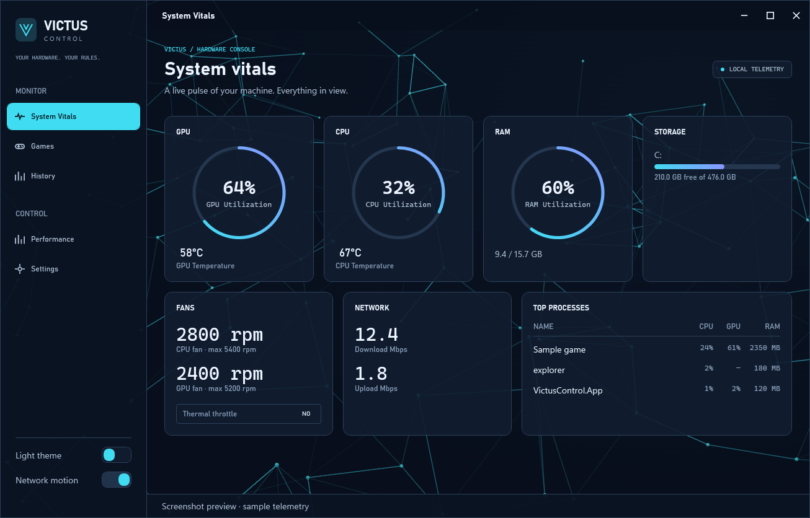
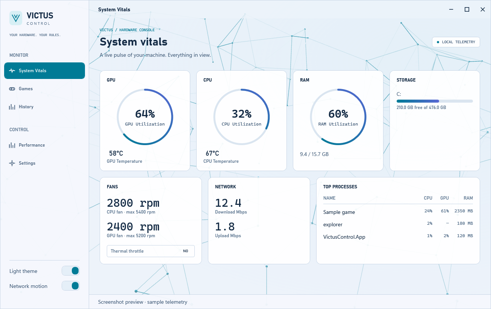
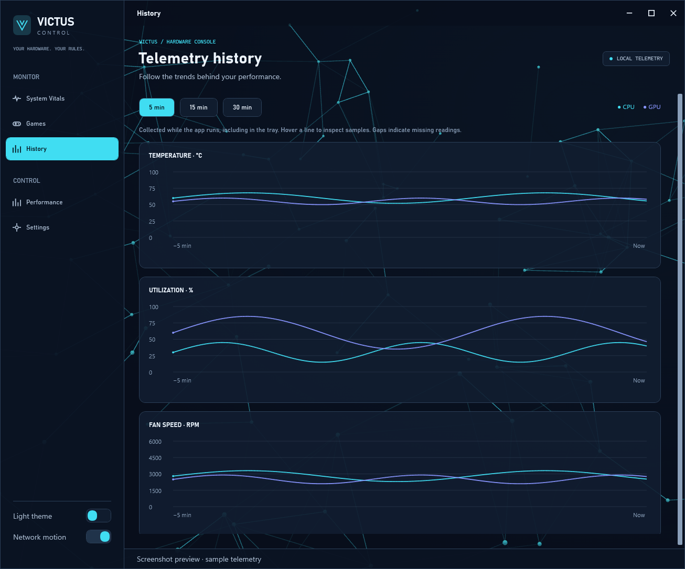
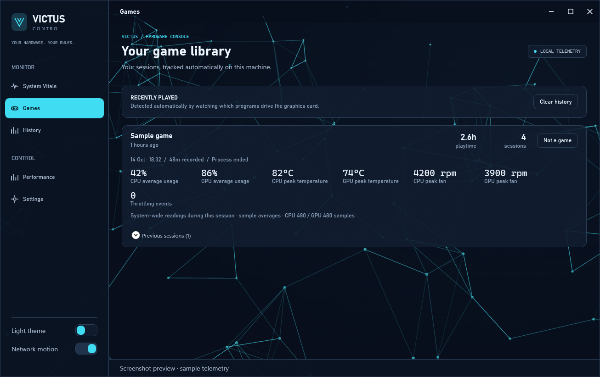
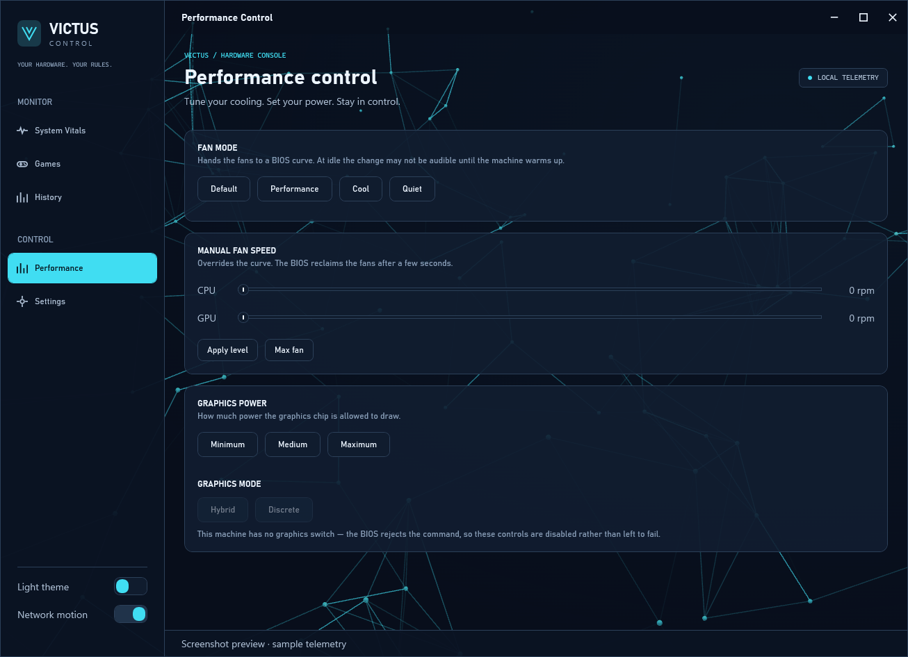
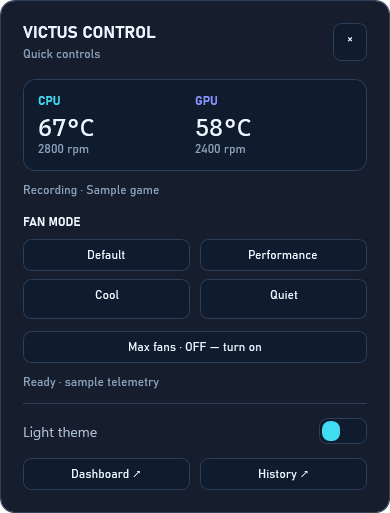

# Victus Control

Direct access to your HP Victus or Omen laptop's hardware controls. No ads, no account, no bloat. Just real-time monitoring and fan control in a lightweight system tray application.

## Why Victus Control?

Omen Gaming Hub provides access to your laptop's thermal and performance settings, but it includes ads, requires an account, runs background services, and adds latency between you and your hardware. Victus Control strips all that away.

**What you get:**
- Direct access to HP BIOS controls via WMI
- Real-time CPU, GPU, memory, storage, and network telemetry
- Fan mode and speed control
- GPU power level adjustment
- Minimal resource footprint (runs safely during gaming)
- Dark and light themes
- Honest reporting (unsupported features are clearly marked unavailable)

## Getting started

### Requirements

- Windows 11 on an HP Victus or Omen laptop
- Administrator privileges (required for fan and power controls)
- NVIDIA driver (for GPU telemetry on systems with NVIDIA GPUs)
- Microsoft Edge WebView2 Runtime for the animated network background. If it is unavailable, the native dashboard remains usable with a static background.

### Installation

1. Download the installer from the latest release: [Victus Control v0.0.1](https://github.com/UndoingSky/victus_control/releases/tag/v0.0.1)
2. Run `VictusControl.Setup.exe` as Administrator
3. Launch Victus Control from the desktop shortcut or Start Menu entry

Or from the command line:

```powershell
dotnet build VictusControl.sln
cd src\VictusControl.App\bin\Debug\net8.0-windows10.0.17763.0
.\VictusControl.App.exe
```

### Release download

The published installer is here:

`https://github.com/UndoingSky/victus_control/releases/tag/v0.0.1`

The installer creates `C:\Program Files\Victus Control`, installs the app there, and creates desktop plus Start Menu shortcuts. Windows does not allow silent pinning to Start, so the installer creates the Start Menu entry and you can pin it from there.

### First run

When you first launch Victus Control, it will attempt to connect to your laptop's BIOS interface via WMI. If the connection fails, you will see a message. Administrator elevation is permanent requirement because the HP BIOS WMI interface will not respond to unelevated callers.

The app lives in your system tray when closed. Click its tray icon for quick controls,
double-click to open the dashboard, or right-click for Open and Quit.

## Usage

### Monitoring tab

Displays live system telemetry: CPU usage and temperature, GPU usage and temperature, RAM, storage, network, and any running games.

### Performance tab

Adjust fan modes (Default, Performance, Cool, Quiet) and GPU power levels (Minimum, Medium, Maximum TGP). Max Fan mode forces maximum cooling when active.

Note: Manual fan levels are reclaimed by the BIOS fan curve after a few seconds. The interface must not imply a change failed when it merely has not taken effect yet.

### Games tab

Tracks games you have launched. Game detection runs in the background even when the app is minimized in the tray.

Each detected session records duration, average CPU/GPU usage, peak temperatures,
peak fan RPM, and observed throttling events. These are system-wide readings during
the session, with averages over available samples. Unavailable sensors show a dash.
The newest 20 summaries per game are kept locally in `%APPDATA%\VictusControl\games.json`,
checkpointed every 30 seconds and saved when sessions end. Existing game totals are
preserved; summaries begin with new sessions. Detection uses sustained 3D activity,
so non-game graphics apps can occasionally appear; use **Not a game** to exclude them.

### History tab

CPU/GPU temperature, usage, and fan RPM graphs offer 5, 15, and 30 minute views.
Hover for values at a timestamp. History collects while the app runs, including in
the tray, and resets when the app exits. Sampling slows in the tray; long outages
appear as gaps. Missing sensor readings are never recorded as zero.

### Tray quick controls

A single click opens a compact panel with live temperatures, fan RPM, active game,
four fan modes, maximum fan control, theme switch, and Dashboard/History shortcuts.
Click outside or press Escape to dismiss. Hardware controls are disabled when the
BIOS interface is unavailable or a command is pending.

### Settings

Theme and network-motion preferences are saved between runs. The Settings page
reports hardware support and application details.

### Appearance

The dashboard uses navy and cyan surfaces, translucent cards, Bahnschrift headings,
Segoe UI body text, and monospaced telemetry. Both dark and light themes are available
in the sidebar. Fonts fall back to standard Windows fonts if needed.

The background runs Vanta NET 0.5.24 with Three.js r134 in a WebView2 composition
layer beneath the native controls. Scripts are bundled locally; no CDN or internet
connection is needed at runtime. Mouse and touch movement interact with the network
without intercepting controls. The **Network motion** switch is saved between runs.
Animation stops when the window is minimized or hidden in the tray and respects
Windows' animation setting and the browser's reduced-motion preference.

## Screenshots

The current interface, including the Vanta NET background, history graphs, game
session summaries, and tray quick controls. Captured with sample telemetry and
example game data for illustration; these are not benchmark results.

**System vitals — dark theme**



**System vitals — light theme**



**History — temperature, utilization, and fan speed**



**Games — recorded session summaries**



**Performance — fan and graphics controls**



**Tray quick controls**

Single-click the tray icon to open this panel. Double-click to open the dashboard.



## Project structure

- `src/VictusControl.App`: WPF user interface, system tray integration, and theme management
- `src/VictusControl.Core`: BIOS access, system monitoring (CPU, GPU, memory, network), and game tracking
- `src/VictusControl.Diag`: Standalone diagnostic tool for probing hardware capabilities

## Development

### Building

```powershell
dotnet build VictusControl.sln
```

Run the history and session checks with `dotnet run --project tests/VictusControl.Checks`.

### Supported hardware

Developed and tested on:
- HP Victus with Intel i5 13th gen and RTX 4050

Other Victus and Omen laptops may have varying levels of hardware support. Use `VictusControl.Diag` to probe your specific machine.

### Known limitations

- GPU mode/MUX switching is not supported on all hardware (shows as unavailable, never offers a control that will fail silently)
- Manual fan levels are reclaimed by the BIOS curve after a few seconds
- Fan RPM changes lag behind mode changes at idle
- GPU telemetry requires the NVIDIA driver

## Troubleshooting

### BIOS interface unavailable

If you see "BIOS interface unavailable" on startup:
1. Restart the app with administrator privileges
2. Your laptop may not support WMI-based BIOS access (uncommon on Victus/Omen)
3. Run `VictusControl.Diag` to probe your hardware

### Fans are not responding to controls

- Manual fan levels are temporary and will be reclaimed by the BIOS fan curve within seconds
- Ensure you have administrator privileges
- Try switching to a different fan mode and back again

### GPU stats show as unavailable

- Verify your NVIDIA driver is installed and up to date
- GPU power level controls only work on systems that support them

### Performance

When the window is minimized, polling intervals increase and the network animation
is destroyed to reduce CPU/GPU work. The animated background adds WebView2 browser
processes and GPU usage; switch off **Network motion** for a static background.

## License

This project is distributed under the GPL 3.0 license. See THIRD_PARTY_NOTICES.md for third party attribution, including the OmenMon project (GPL 3.0) which provided the HP BIOS protocol constants.
